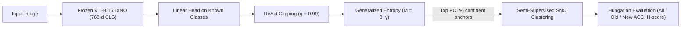
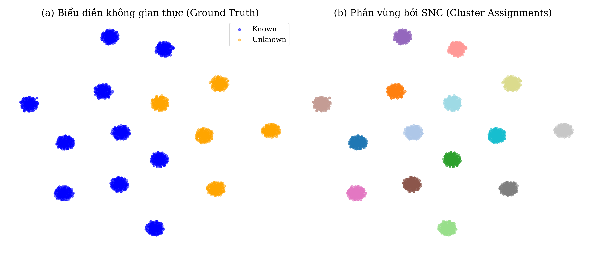
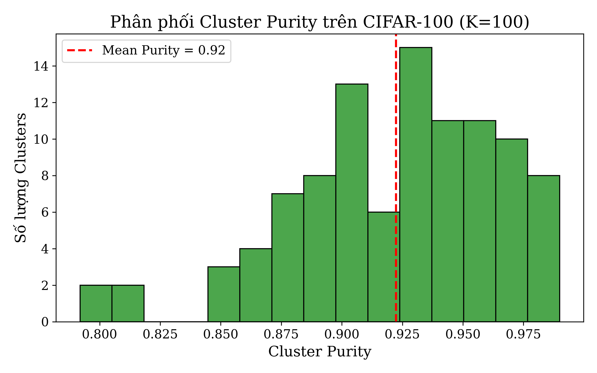
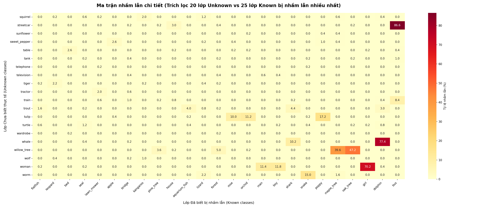

# GESNC — GEN-Augmented Semi-Supervised SNC for Generalized Category Discovery

[](https://www.python.org/downloads/release/python-3100/)
[](https://pytorch.org/)
[](LICENSE)

Experimental evaluation pipeline for **Generalized Category Discovery (GCD)** and Out-of-Distribution (OOD) uncertainty quantification on **CIFAR-100** (80 known / 20 unknown classes) and **CUB-200-2011** (100 known / 100 unknown classes).

> **Graduation Thesis (9.18 / 10)** — Ho Chi Minh City University of Technology (VNUHCM–HCMUT).  
> **Companion Training Repository:** See [**Train-cub200**](https://github.com/Yato742003/Train-cub200) for the 200-epoch Cloud GPU CiPR backbone training and checkpointing pipeline.

---

## Overview

**GESNC** addresses Softmax overconfidence on unseen categories without fine-tuning or retraining the underlying Vision Transformer backbone:

1. **Frozen Feature Extraction:** Uses pre-trained **ViT-B/16 DINO** (`768`-dim `[CLS]` embeddings).
2. **Linear Probing:** Trains a lightweight linear classifier head on labeled known-class samples.
3. **Post-Hoc Activation & Tail Bounding:** Applies **ReAct** activation clipping (`q = 0.99`) and **Generalized Entropy (GEN)** with Top-$M$ probability truncation (`M = 8`) to separate confident in-distribution anchors from uncertain open-world samples.
4. **Semi-Supervised SNC Clustering:** Combines ground-truth labeled instances with the top `PCT%` lowest-entropy pseudo-labeled anchors inside **Selective Neighbor Clustering (SNC)**, followed by Hungarian matching evaluation (`All ACC`, `Old ACC`, `New ACC`, `H-score`).



---

## Trade-offs & Design Decisions

- **Frozen Backbone + Post-Hoc OOD Bounding Over End-to-End Retraining:** Keeping ViT-B/16 DINO frozen avoids expensive multi-GPU contrastive retraining on 16 GB T4/L4 GPUs while still improving fine-grained cluster purity through post-hoc logit calibration (`GEN` + `ReAct`).
- **Top-M Truncation (`M = 8`) & ReAct Clipping (`q = 0.99`):** Standard Softmax entropy is distorted by long-tail noise across 100–200 classes and outlier feature activations; clipping extreme activations before computing truncated Generalized Entropy yields cleaner pseudo-label anchors for SNC.
- **Coarse vs. Fine-Grained Regime Trade-off:** Multi-seed paired *t*-tests show statistically significant gains across all 4 metrics on fine-grained **CUB-200-2011** (`p < 0.05`), whereas on low-resolution 32×32 **CIFAR-100**, GESNC improves `New ACC` (`+0.44%`) at the cost of minor `Old ACC` drift due to tightly overlapping visual pairs (`streetcar → bus`, `whale → dolphin`) documented in `results/failure_analysis_report.txt`.

---

## Experimental Results & Visualizations

### 1. CUB-200-2011 (Fine-Grained: 100 Known / 100 Unknown — 3-Seed Paired *t*-Test)

Evaluated across 3 random seeds (`run_multi_seed.py`, logged in [`results/cub200_multi_seed_final.csv`](results/cub200_multi_seed_final.csv)):

| Method | All ACC (%) | Old ACC (%) | New ACC (%) | H-score (%) |
| :--- | :---: | :---: | :---: | :---: |
| CiPR Baseline (Pure SNC) | `58.50 ± 0.00` | `69.33 ± 0.00` | `53.07 ± 0.00` | `60.12 ± 0.00` |
| **GESNC (Proposed)** | **`58.92 ± 0.12`** | **`70.40 ± 0.37`** | **`53.17 ± 0.00`** | **`60.59 ± 0.14`** |
| *Improvement* | *+0.42%* | *+1.07%* | *+0.10%* | *+0.46%* |
| *Paired t-test p-value* | `p = 0.0275` | `p = 0.0381` | `p < 0.01` | `p = 0.0283` |

### 2. CIFAR-100 (80 Known / 20 Unknown — Frozen ViT-B/16 DINO on Tesla T4 / L4)

| Configuration | All ACC (%) | Old ACC (%) | New ACC (%) | H-score (%) |
| :--- | :---: | :---: | :---: | :---: |
| Pure SNC Baseline (`PCT = 0`) | `81.50` | `82.40` | `79.70` | `81.03` |
| **GESNC (`PCT = 10, M = 8, γ = 0.2, ReAct`)** | **`84.82`** | **`87.18`** | **`80.10`** | **`83.49`** |

In multi-seed testing against full CiPR (`results/cifar100_multi_seed_final.csv`), GESNC increases **New ACC by +0.44%** (`80.96%` vs. `80.52%`) while trading off slight known-class accuracy on coarse 32×32 images.

### 3. Visual Analysis (`results/`)

| t-SNE Embedding Structure | Pseudo-Label Anchor Purity vs. PCT |
| :---: | :---: |
|  |  |

**Semantic Confusion Analysis (20 Unknown × 80 Known Classes on CIFAR-100):**  
Automated failure analysis (`analyze_failures.py` → [`results/failure_analysis_report.txt`](results/failure_analysis_report.txt)) shows that open-world misclassifications concentrate in visually overlapping semantic pairs (`streetcar → bus`: 86.6%, `whale → dolphin`: 77.4%, `woman → girl`: 70.2%):



---

## Repository Structure

```text
GCD_GESNC/
├── checkpoints/               # Place ViT-B/16 DINO checkpoints here (cifar100/final.pth, cub200/final.pth)
├── features/                  # Cached 768-d feature tensors generated by extract_features.py
├── results/                   # Multi-seed CSV benchmarks, logs, failure reports, and plots
├── src/
│   ├── models/                # ViT-B/16 architecture
│   ├── pipeline/              # Semi-supervised SNC clustering wrapper
│   ├── snc/                   # Selective Neighbor Clustering core
│   └── utils/                 # Generalized Entropy (gen_entropy.py) & Hungarian accuracy metrics
├── extract_features.py        # Feature extraction for CIFAR-100
├── main_eval.py               # CIFAR-100 single-run and ablation evaluation
├── eval_cub_gesnc.py          # CUB-200-2011 extraction and evaluation
├── run_multi_seed.py          # Multi-seed runner with paired Student's t-test
├── analyze_failures.py        # 20x80 semantic confusion matrix & per-class breakdown
├── ablation_cifar_full.sh     # Full hyperparameter ablation script
└── requirements.txt           # Pinned dependencies
```

---

## Quickstart

### 1. Environment Setup
```bash
git clone https://github.com/Yato742003/GCD_GESNC.git
cd GCD_GESNC

python3 -m venv .venv
source .venv/bin/activate      # Windows: .venv\Scripts\activate
pip install --upgrade pip
pip install torch==2.1.0 torchvision==0.16.0 --index-url https://download.pytorch.org/whl/cu121
pip install -r requirements.txt
```

### 2. Extract Features & Run Evaluation
```bash
# CIFAR-100 feature extraction + GESNC evaluation
python extract_features.py --pretrain checkpoints/cifar100/final.pth --output_dir features/
python main_eval.py --protocol transductive --pct 10 --m 8 --gamma 0.2 --react --feat_dir features/

# CUB-200-2011 evaluation
python eval_cub_gesnc.py --data_root ~/cipr_cub200/data/CUB_200_2011 --pretrain checkpoints/cub200/final.pth --pct 10 --m 8 --gamma 0.1

# Multi-seed benchmark + paired t-test (CIFAR-100 & CUB-200)
python run_multi_seed.py --dataset both

# Generate failure analysis report & confusion figures
python analyze_failures.py
```

---

## References

- **CiPR:** Hao et al., *"CiPR: An Efficient Framework with Cross-Instance Positive Relations for Generalized Category Discovery"*, 2024.
- **DINO:** Caron et al., *"Emerging Properties in Self-Supervised Vision Transformers"*, ICCV 2021.
- **GEN:** Liu et al., *"GEN: Pushing the Limits of Softmax-Based Out-of-Distribution Detection"*, CVPR 2023.
- **ReAct:** Sun et al., *"ReAct: Out-of-Distribution Detection With Rectified Activations"*, NeurIPS 2021.

---

## License

Released under the [MIT License](LICENSE).
